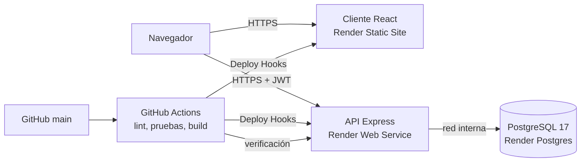

# Arquitectura

Versión 1.0.0 · 23 de octubre de 2026

## Problema

Un equipo de seguridad necesita un solo lugar para registrar los incidentes (phishing, malware, accesos no autorizados, fallos de disponibilidad y vulnerabilidades), saber cuáles tienen prioridad alta y seguir su estado hasta resolverlos. No todas las personas deben poder hacer lo mismo: quien registra no debería borrar registros.

## Vista general




Diagrama editable: `evidencias/Unidad 8/diagrama-arquitectura.drawio`.

- El cliente y la API están en dominios distintos. El navegador descarga el cliente del Static Site y llama a la API directamente; la API decide con CORS qué origen acepta.
- La API usa la URL interna de la base: el tráfico no sale de la red de Render.
- Delante de los dos servicios están Cloudflare y el balanceador de Render, que terminan HTTPS y redirigen HTTP con un 301.

## Capas del backend

```text
routes → middleware → controllers → services → models → Prisma → PostgreSQL
```

| Capa | Responsabilidad |
| --- | --- |
| `routes/` | Ruta, método, permiso y esquema de cada operación |
| `middleware/` | Registro, autenticación, permisos, validación, límites y errores |
| `controllers/` | Leer la solicitud y elegir el código HTTP (201 con `Location`, 204 sin cuerpo) |
| `services/` | Reglas del negocio: códigos `INC-001`, filtros y paginación |
| `models/` | Consultas con Prisma, siempre parametrizadas |
| `validaciones/` | Esquemas de zod y limpieza de texto con sanitize-html |
| `config/` | Variables de entorno, permisos por rol y cliente de Prisma |

El orden del middleware en `app.js` es: registro (id de solicitud), Helmet, CORS, límite por IP, compresión, `Cache-Control: no-store` y JSON de hasta 100 KB. En las rutas de incidentes se revisa primero el token, luego el permiso y al final el cuerpo: quien no tiene permiso recibe 403 sin conocer las reglas del formulario.

## Cliente

React 19 con Vite y Tailwind. `frontend/src/services/api.js` concentra las llamadas a la API, guarda el token en `sessionStorage` y, ante un 401, vuelve a la pantalla de inicio de sesión. La interfaz oculta los botones que el rol no puede usar, pero quien decide es la API.

## Datos

| Tabla | Campos principales |
| --- | --- |
| `Incidente` | `titulo` (único), `tipo`, `fecha`, `prioridad`, `estado`, `descripcion`, `correo`, `evidencia`, `createdAt`, `updatedAt` |
| `Usuario` | `nombre`, `correo` (único), `passwordHash`, `rol`, `activo` |

- `prioridad`, `estado` y `rol` son enumeraciones de PostgreSQL.
- Hay un índice en `estado` y otro compuesto en `(prioridad, estado)` para los filtros de la lista.
- La API muestra el id como `INC-001`; en la base es un entero autoincremental.
- El esquema está en `prisma/schema.prisma` y se crea con una sola migración, `202610220001_postgresql_inicial`.

## Seguridad

| Control | Dónde |
| --- | --- |
| Contraseñas con bcrypt (costo 12) | `prisma/seed.cjs`, `controllers/auth.js` |
| JWT HS256 de 30 minutos con solo `id` y `rol` | `utils/token.js` |
| Rol y cuenta activa revisados en cada solicitud | `middleware/autenticacion.js` |
| Permisos por rol en un solo archivo | `config/permisos.js` |
| Validación estricta y limpieza de HTML | `validaciones/` con zod y sanitize-html |
| Consultas parametrizadas | Prisma |
| 5 intentos de inicio de sesión cada 15 min; 100 solicitudes por minuto por IP | `middleware/limites.js` |
| Encabezados seguros y sin `X-Powered-By` | Helmet en la API; Headers del Static Site |
| CORS solo para el dominio del cliente | `app.js` y `CLIENT_ORIGIN` |
| HTTPS y HSTS | Render |
| Errores sin trazas ni consultas | `middleware/errores.js` |
| Secretos fuera del repositorio | Render Environment y GitHub Secrets |

## Decisiones

**PostgreSQL en lugar de MySQL.** Hasta la Unidad 7 usamos MySQL en Docker. Render solo ofrece bases administradas de PostgreSQL. Con Prisma bastó cambiar el proveedor y rehacer la migración; el código de los modelos no cambió.

**Render para todo.** La base, la API y el cliente quedan en la misma región, y la API usa la URL interna de la base. La práctica guiada proponía Vercel para el cliente; preferimos el Static Site de Render para manejar una sola cuenta y configurar los encabezados del cliente en el mismo panel.

**Deploy Hook con Auto-Deploy en Off.** Render también puede esperar a que pasen los checks de GitHub. Elegimos el Deploy Hook porque en el workflow se ve quién ordena el despliegue y con qué condición, y porque después del despliegue el mismo workflow verifica producción.

**Verificación después de cada despliegue.** Las pruebas de integración prueban el código, no la configuración de Render. El cuarto trabajo del workflow encontró un `CLIENT_ORIGIN` sin actualizar que ninguna prueba local podía detectar.

**`TRUST_PROXY=3`.** Primero pusimos 1. Con `DEPURAR_IP=1` vimos que la IP del log era la del balanceador interno (`10.x`); con eso, todos los usuarios habrían compartido el mismo límite de solicitudes. Una prueba de integración fija el valor en 3 y comprueba que un `X-Forwarded-For` inventado no evade el límite.

**Node 24 fijo en `.node-version`.** La primera ejecución de Actions usó Node 22 y Jest no pudo cargar `htmlparser2`, que solo se publica como ESM. Desde entonces Actions y Render leen el mismo archivo.

## Límites

- Es un prototipo académico con datos de demostración. Para información institucional faltarían respaldos, un plan pago sin suspensión, revisión de accesos y un acuerdo sobre quién mantiene el servicio.
- El token vive en `sessionStorage`: un XSS podría leerlo. La CSP sin `unsafe-inline` y la limpieza de HTML reducen ese riesgo, pero una cookie `HttpOnly` sería mejor.
- No hay revocación de tokens: un token robado sirve hasta 30 minutos, aunque un cambio de rol o una cuenta desactivada se aplican de inmediato.
- El límite de solicitudes está en memoria; con más de una instancia haría falta un almacén compartido.
- La evidencia del incidente es solo el nombre del archivo; no se suben archivos.
- No hay pruebas automáticas de la interfaz en el navegador; se probó a mano y con DevTools.
